# Lab 03 – 7-Segment Display Controller


A 7-segment display controller for the Digilent **Nexys A7-100T** (Artix-7) FPGA.
The user sets a 16-bit value on the switches and **holds a button for 1 second** to latch it.
The value is shown in **decimal** (Center button) or **hexadecimal** (Down button), with leading-zero blanking and no visible flicker.

Part of the *Chip Design & Verification* program (Google × NVIDIA, Reichman University).

<p align="center">
  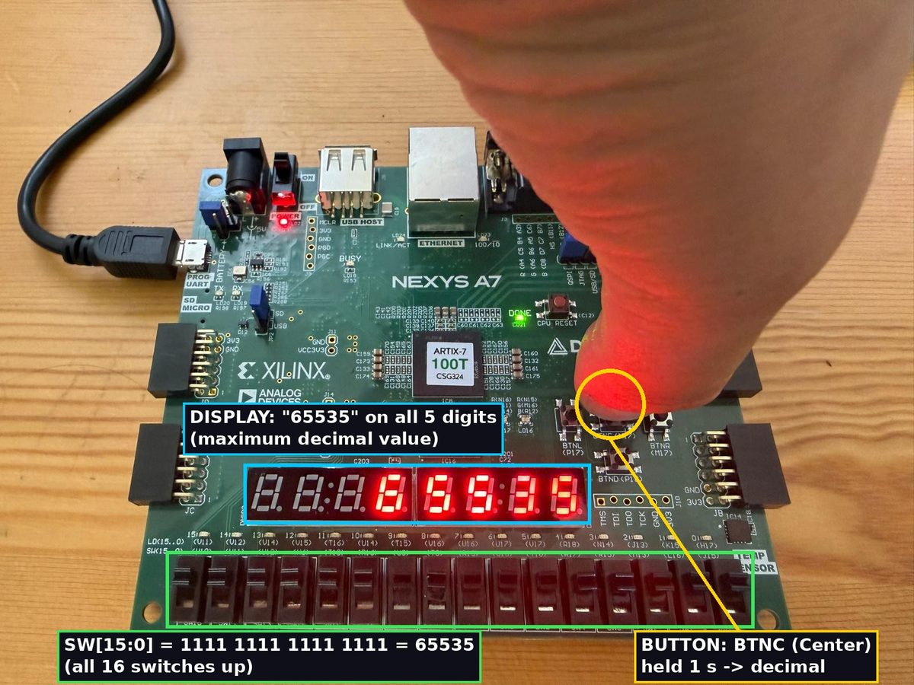
  &nbsp;
  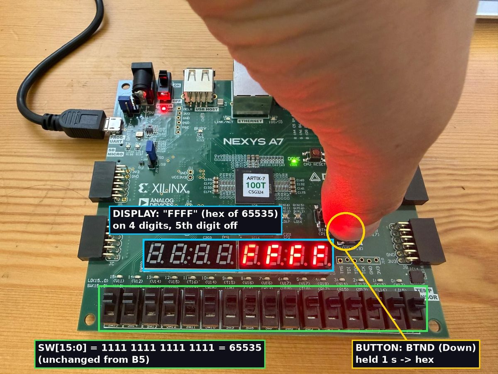
</p>
<p align="center"><i>Same switches, two display modes: 65535 (Center held 1 s) and FFFF (Down held 1 s)</i></p>

---

## Features

- **Decimal or hex display** of the 16-bit switch value, selected by the button that was held
- **1-second hold to latch** – the display ignores the switches until the next latch
- **One latch per press** – holding the button longer never re-latches
- **Leading-zero blanking** – `5` is shown as `5`, not `00005`; the value `0` still shows a single `0`
- **Flicker-free multiplexing** – 400 Hz digit scan (80 Hz refresh per digit)
- **Single clock domain** – all timing uses one-cycle enable pulses, no divided clocks
- **2-FF synchronizers** on the push-buttons against metastability

## Specification

| Signal | Dir | Width | Polarity | Board |
|---|---|---|---|---|
| `clk` | in | 1 | – | 100 MHz oscillator (E3) |
| `rst_n` | in | 1 | active low | CPU RESET (C12) |
| `sw` | in | 16 | active high | SW15..SW0 |
| `btn_c` | in | 1 | active high | BTNC – latch in decimal |
| `btn_d` | in | 1 | active high | BTND – latch in hex |
| `an` | out | 8 | active low | Digit anodes AN7..AN0 |
| `seg` | out | 7 | active low | Cathodes CA..CG (`seg[0]` = CA) |

| Requirement | Cycles | Counter width |
|---|---|---|
| 400 Hz digit refresh | 250,000 × 10 ns | 18 bits |
| 1 s button hold | 400 ticks of 400 Hz | 9 bits |

---

## Architecture

<p align="center">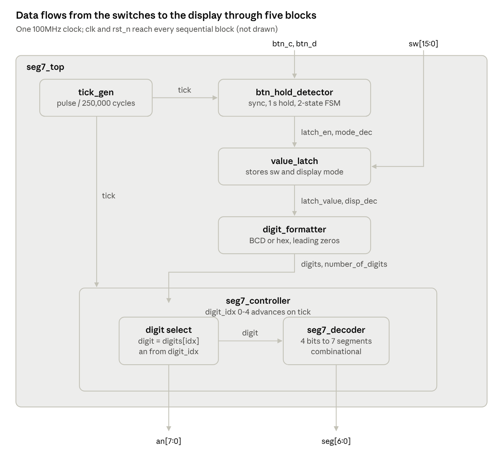</p>

| Module | Type | Role |
|---|---|---|
| [`tick_gen`](src/tick_gen.v) | Sequential | One-cycle enable pulse every 250,000 cycles (400 Hz) |
| [`btn_hold_detector`](src/btn_hold_detector.v) | Sequential | Button sync, 1 s hold counter, 2-state FSM → single `latch_en` pulse |
| [`value_latch`](src/value_latch.v) | Sequential | Stores the switch value and display mode on `latch_en` |
| [`digit_formatter`](src/digit_formatter.v) | Combinational | Binary → 5 BCD digits or 4 hex digits, counts digits to light |
| [`seg7_controller`](src/seg7_controller.v) | Sequential | Digit scan counter, digit select, active-low anodes |
| [`seg7_decoder`](src/seg7_decoder.v) | Combinational | 4-bit digit → 7 active-low segments (0–F) |
| [`seg7_top`](src/seg7_top.v) | Top | Wiring only; `TICK_MAX` / `HOLD_TICKS` parameters for fast simulation |

### Hold-detector FSM

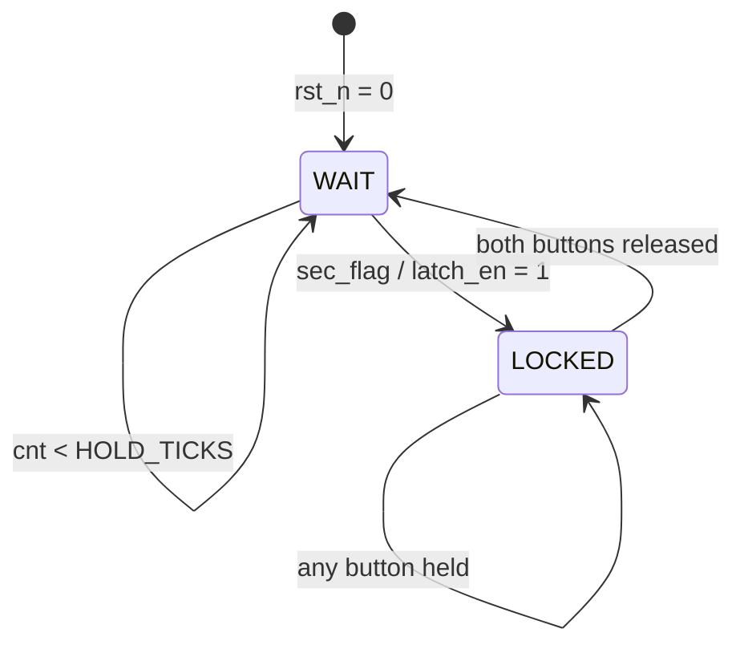

`latch_en = (state == WAIT) && sec_flag` – the pulse fires only on the WAIT → LOCKED transition, so a long hold (where the 9-bit counter wraps and reaches `HOLD_TICKS` again) never latches twice. `mode_dec = btn_c_sync` gives Center priority when both buttons are pressed.

### Key design decisions

- **Enable pulses instead of divided clocks.** A divided clock would leave the dedicated clock network, add skew and create a clock-domain crossing. Here everything runs on the 100 MHz clock, and `tick` acts as an enable.
- **Reuse of the 400 Hz tick for the 1 s timer** – a 9-bit counter instead of a separate 27-bit one.
- **Debouncing for free.** The hold counter resets on every release, so contact bounce only delays the latch by a few ms.
- **Constant scan of all 5 digits** – every digit gets the same on-time, so brightness does not depend on how many digits are shown. Leading zeros are blanked through the anodes only.

---

## Verification

Each block has its own testbench, plus an end-to-end testbench for the top level. Timing parameters are reduced in simulation so the "1 second" hold takes **100 ns**; the real values stay as defaults for hardware. Markers (M1, M2, …) mark the key moments in each waveform.

| Testbench | What it checks |
|---|---|
| [`seg7_decoder_TB`](sim/seg7_decoder_TB.v) | All 16 characters 0–F |
| [`tick_gen_TB`](sim/tick_gen_TB.v) | One-cycle pulse every `MAX+1` cycles (no off-by-one) |
| [`btn_hold_detector_TB`](sim/btn_hold_detector_TB.v) | Normal hold, short press, both buttons, staggered release, 27 µs long hold |
| [`value_latch_TB`](sim/value_latch_TB.v) | Latch, hold while switches change, async reset |
| [`digit_formatter_TB`](sim/digit_formatter_TB.v) | 0, 7, 1234, 65535 in decimal and hex; digit count |
| [`seg7_controller_TB`](sim/seg7_controller_TB.v) | Anode toggling on every digit, all characters, blanking |
| [`seg7_top_TB`](sim/seg7_top_TB.v) | End to end: latch 1234 in decimal, then 4D2 in hex, then reset |

<details>
<summary><b>Waveforms (click to expand)</b></summary>

**seg7_top – end to end**
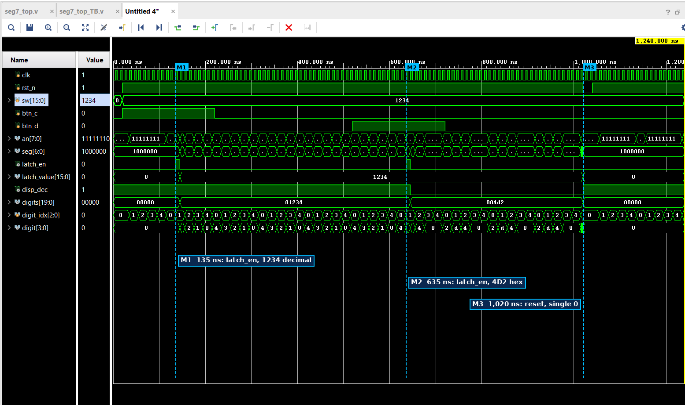

**btn_hold_detector – single latch per press**
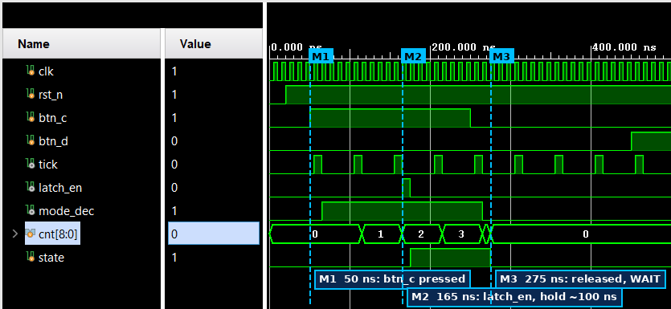

**btn_hold_detector – long hold, counter wraps, no second latch**
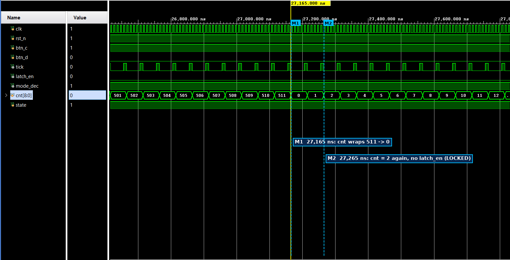

**value_latch – display ignores the switches until latch_en**
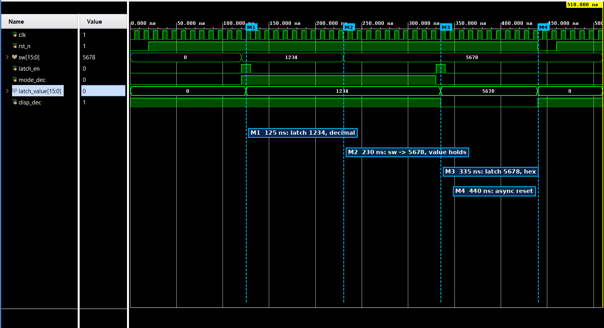

**digit_formatter – BCD and hex digits**
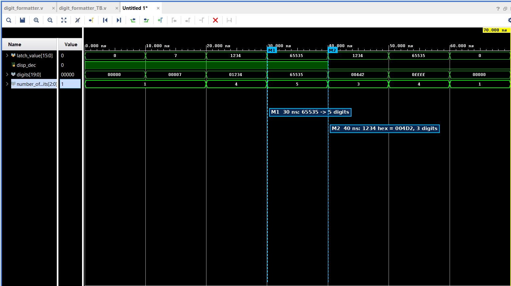

**seg7_controller – digit scan and leading-zero blanking**
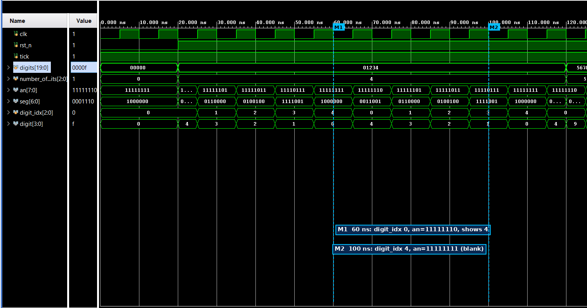
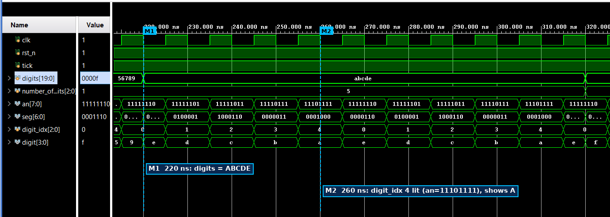
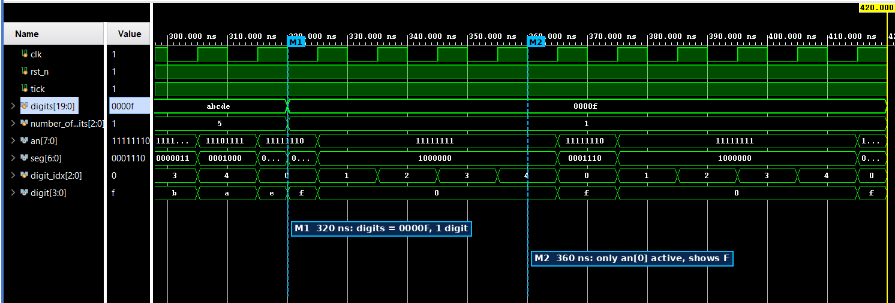

**tick_gen – 40 ns period with MAX = 3**
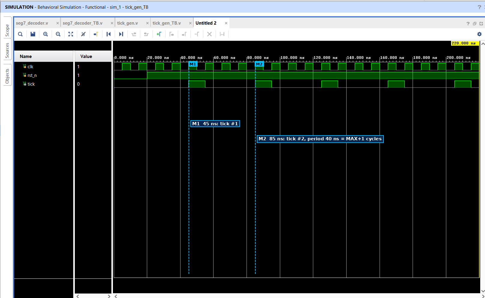

**seg7_decoder – all 16 characters**
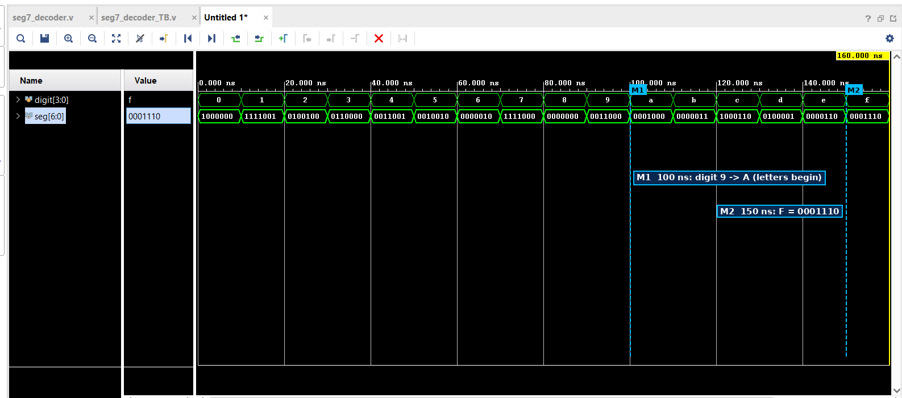

</details>

---

## Implementation Results

Device: **xc7a100tcsg324-1** · Clock constraint: **10 ns (100 MHz)**

| Resource | Expected | Used | Utilization |
|---|---|---|---|
| Slice Registers | 52 | 52 | 0.04 % |
| Slice LUTs | a few hundred | 323 | 0.51 % |
| Bonded IOB | 35 | 35 | 16.7 % |
| BUFGCTRL | 1 | 1 | 3.1 % |

| Timing | Value |
|---|---|
| WNS (setup) | **+5.466 ns** |
| WHS (hold) | **+0.197 ns** |
| Failing endpoints | 0 |
| Total on-chip power | 0.112 W |

- Lint: **no violations** · Implementation: **no warnings**
- The register count was estimated by hand before synthesis (52 bits) and matched exactly.
- About 310 of the 323 LUTs come from the binary-to-BCD conversion (`/` and `%` by constants).

<details>
<summary><b>Vivado reports (click to expand)</b></summary>

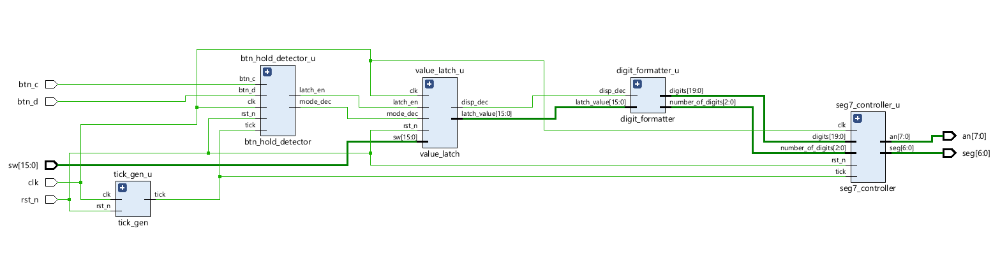
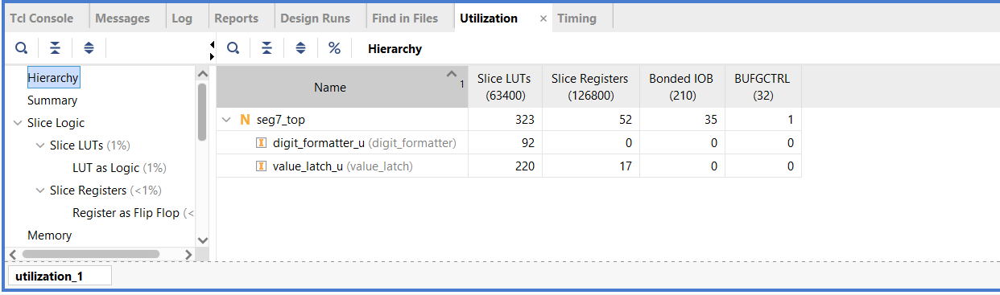
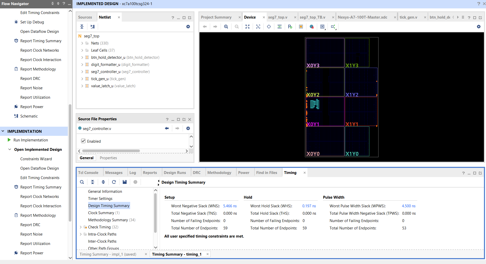
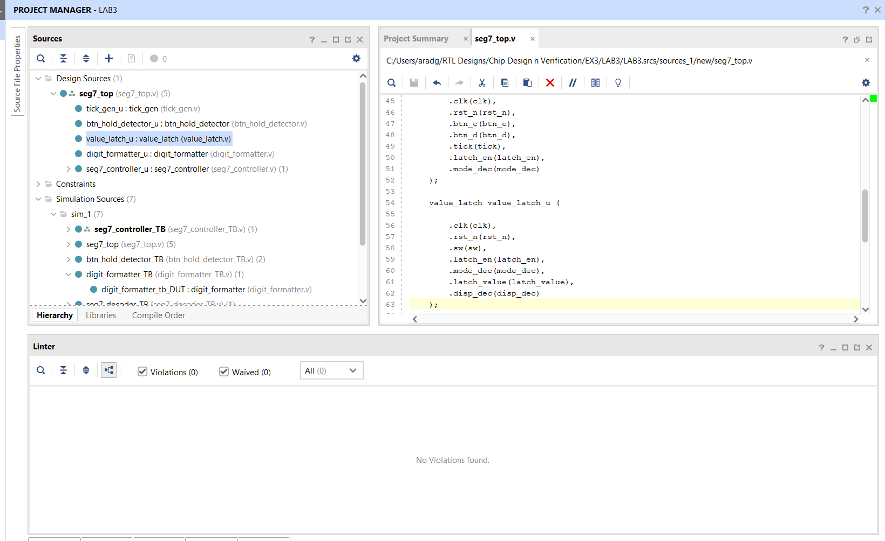

Full text reports are in [`vivado_outputs/reports`](vivado_outputs/reports).
</details>

---

## Hardware Test

| | | |
|---|---|---|
| 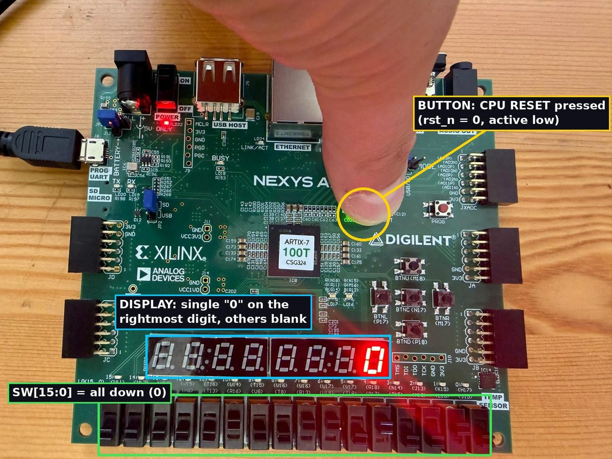 | 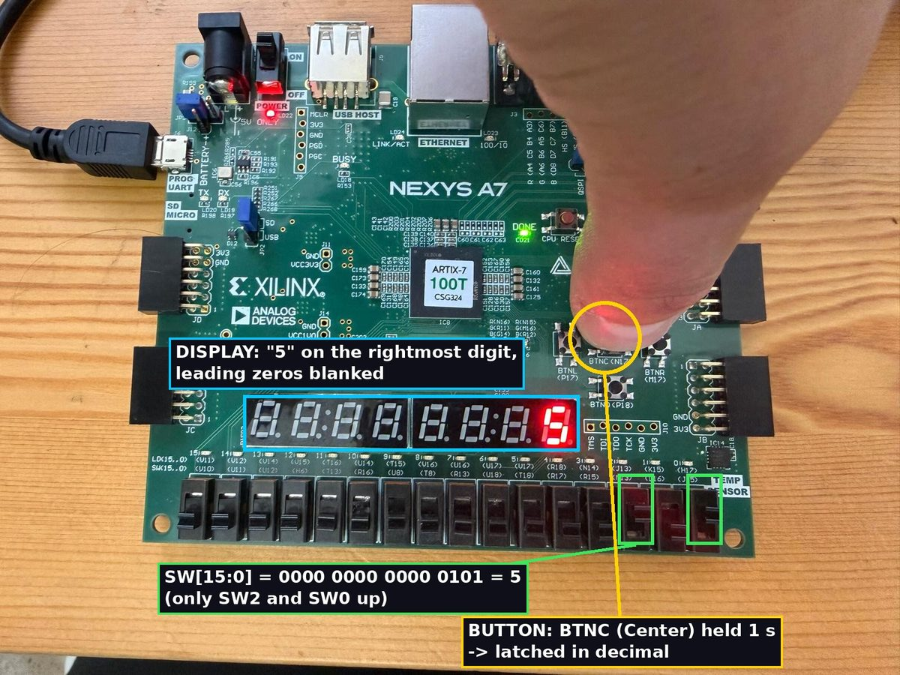 | 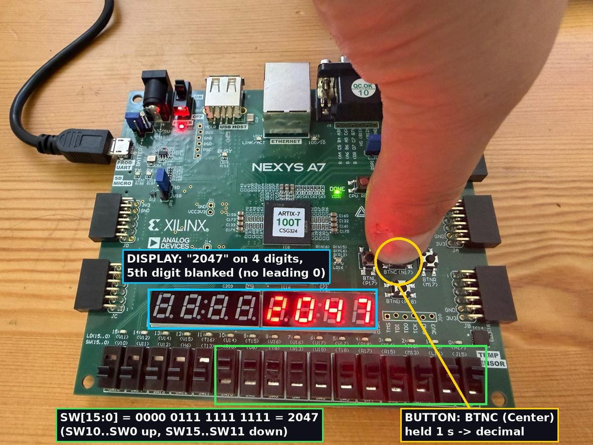 |
| **Reset** – single `0` | **5** – leading zeros blanked | **2047** – decimal, 4 digits |
| 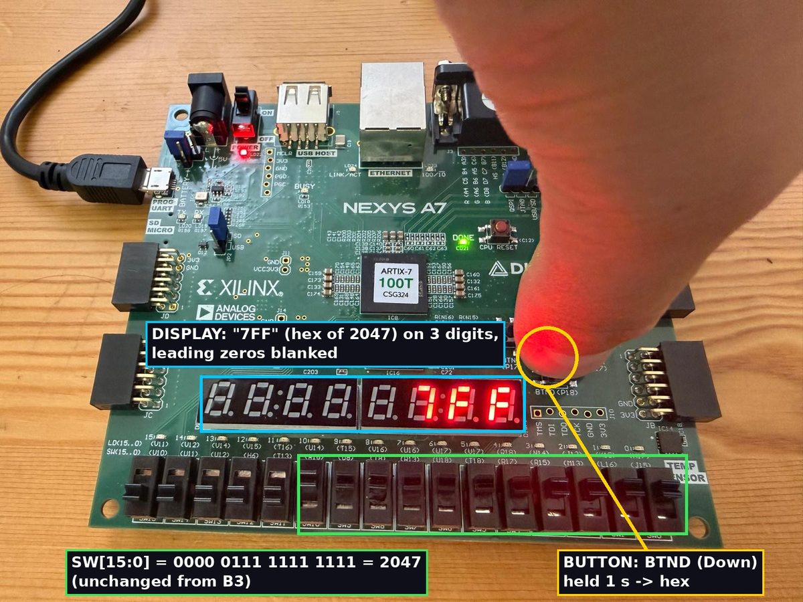 |  |  |
| **7FF** – same value in hex | **65535** – all 5 digits | **FFFF** – max hex |
| 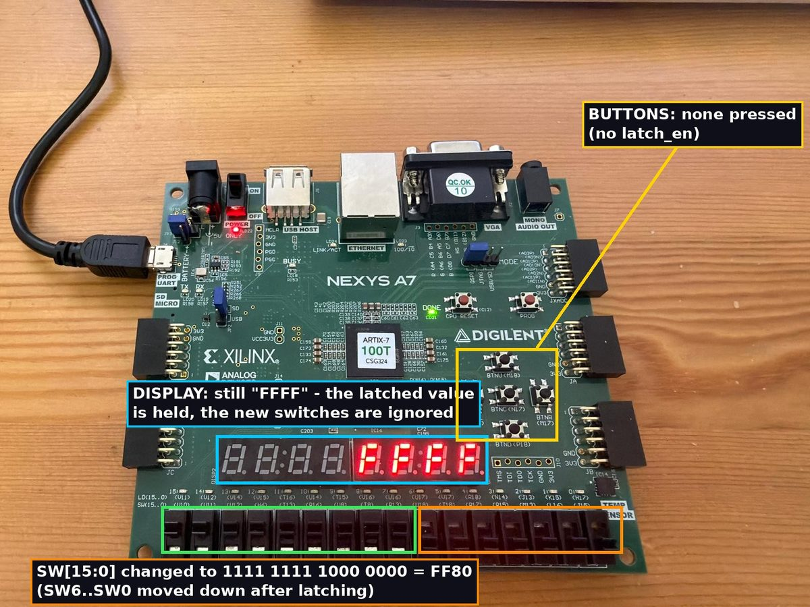 | | |
| **Latch holds** – switches changed, no button, display unchanged | | |

---

## Repository Structure

```
Lab03-7Segment-Controller/
├── src/              # RTL (7 modules, commented)
├── sim/              # Testbenches (7)
├── constraints/      # seg7_top.xdc – Nexys A7-100T pin map
├── vivado_outputs/   # seg7_top.bit + synthesis/implementation reports
└── images/           # Block diagram, waveforms, Vivado reports, board photos
```

## How to Reproduce

1. Create a Vivado project for `xc7a100tcsg324-1`.
2. Add `src/*.v` as design sources (top: `seg7_top`) and `sim/*.v` as simulation sources.
3. Add `constraints/seg7_top.xdc` as a constraint file.
4. Simulate any testbench (Set as Top → Run Behavioral Simulation → Run All).
5. Run Synthesis → Implementation → Generate Bitstream, or program the board directly with `vivado_outputs/seg7_top.bit`.

**On the board:** set the switches, hold **BTNC** for 1 s (decimal) or **BTND** for 1 s (hex). **CPU RESET** clears the display to `0`.

## Known Limitations / Next Steps

- `rst_n` is not synchronized; a reset synchronizer (async assert, sync deassert) would be the standard fix.
- The BCD conversion uses `/` and `%`; a **Double Dabble** implementation would cut the LUT count significantly.
- Testbenches are checked visually; self-checking testbenches (automatic PASS/FAIL) are a natural next step.
