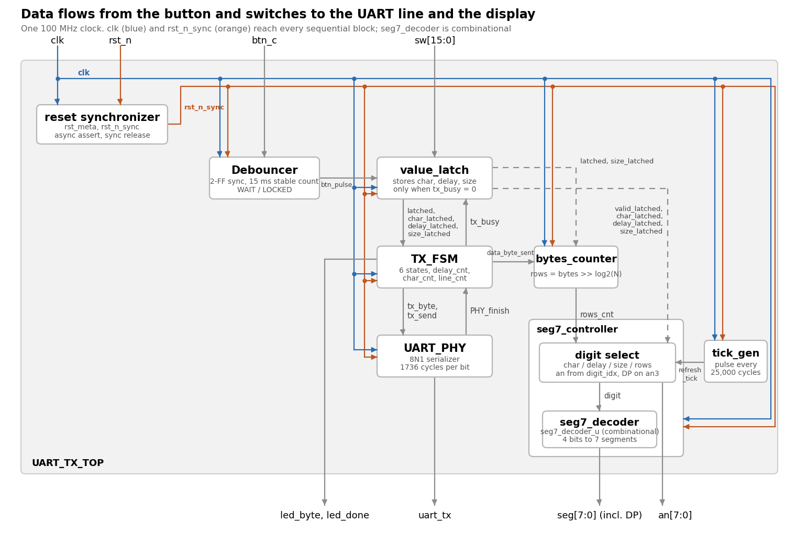
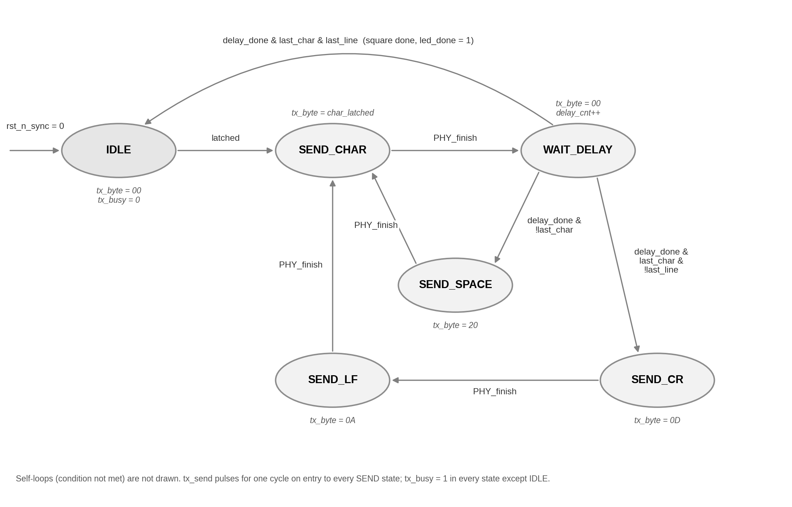

# Lab 04 - UART TX Controller

A UART transmitter on the **Digilent Nexys A7-100T** that sends an N x N square of a character
selected on the switches to a PC terminal (PuTTY, 57600 8N1), and shows the configuration and
progress on the 7-segment display.



## What it does

| Input | Function |
|---|---|
| `SW[7:0]` | Character to send (ASCII, hex) |
| `SW[9:8]` | Delay after each character: 0 / 50 / 100 / 200 ms |
| `SW[14:13]` | Square size N: 1 / 32 / 128 / 256 |
| `BTNC` | Short press (debounced) latches the switches and starts the transmission |
| `CPU_RESETN` | Global reset |

- Each row: N characters separated by spaces (`0x20`), followed by `CR LF` (`0x0D 0x0A`); no `CR LF` after the last row.
- Display: **T0** character, **T1** delay (0.0 / 0.5 / 1.0 / 2.0), **T2** size (01 / 20 / 80 / FF), **T3** rows sent.
- `LD0` toggles on every data character, `LD15` lights when the square is complete.
- Presses and switch changes are ignored while a transmission is running.

## Design

| Module | Type | Role |
|---|---|---|
| `UART_TX_TOP` | Top | Reset synchronizer and block connections |
| `Debouncer` | Sequential | 2-FF sync, 15 ms stable count, one pulse per press |
| `value_latch` | Sequential | Latches the switches only when idle |
| `TX_FSM` | Sequential | Main Moore FSM (3 always blocks, registered outputs) |
| `UART_PHY` | Sequential | 8N1 serializer, 1736 clocks per bit |
| `bytes_counter` | Sequential | Data-byte counter, rows = bytes >> log2(N) |
| `tick_gen` | Sequential | 4 kHz enable pulse for the display scan |
| `seg7_controller` | Sequential | 8-digit scan, value formatting, decimal point, blanking |
| `seg7_decoder` | Combinational | Hex digit to 7 segments (inside `seg7_controller`) |



## Verification

Every block has its own testbench, plus a system testbench for the top level (timing parameters
shortened through module parameters; 100 ns button press in simulation).
Simulation waveforms with markers are in [`images/simulation`](images/simulation).

## Implementation results (xc7a100tcsg324-1, 100 MHz)

| Resource | Used |
|---|---|
| Slice registers | 161 |
| Slice LUTs | 206 |
| Bonded IOB | 34 |
| BUFGCTRL | 1 |

Timing: **WNS = 1.761 ns, WHS = 0.032 ns**, no failing endpoints. Linter clean (2 justified waivers).

## Hardware test

Tested on the Nexys A7 with PuTTY - photos and terminal logs are in [`images/board`](images/board).

## Folder structure

```
rtl/          Design sources
tb/           Testbenches
constraints/  XDC (active lines of the Nexys A7-100T master file)
images/       Block and state diagrams, simulation, board and Vivado flow screenshots
docs/         Full lab report (PDF and Word)
```

Full report: [`docs/Lab04_Report_Arad_Greenshtein.pdf`](docs/Lab04_Report_Arad_Greenshtein.pdf)
