# Lab 05 - UART TRX Controller

Bi-directional UART controller between the Nexys A7-100T and a PC at **57600 bps**, written in **SystemVerilog**.
The design extends the Lab 04 TX controller with an RX path, a message parser and an RX display mode.

- **TX mode (SW15 = 0):** sends an NxN square of a character (N = 1 / 32 / 128 / 256) with a configurable inter-byte delay.
- **RX mode (SW15 = 1):** receives messages in the format `{Rddd,Cddd,Vddd}` and shows row, column and pixel value on the 7-segment display.

## Inputs / Outputs

| Signal | Board | Function |
|---|---|---|
| `sw[7:0]` | SW7-SW0 | character to send |
| `sw[9:8]` | SW9-SW8 | delay: 0 / 50 / 100 / 200 ms |
| `sw[14:13]` | SW14-SW13 | size: 1 / 32 / 128 / 256 |
| `sw[15]` | SW15 | 0 = TX, 1 = RX |
| `btn_c` | BTNC | latch the switches and start TX |
| `rst_n` | CPU RESET | reset (active low) |
| `uart_tx` / `uart_rx` | USB-UART | serial lines |
| `led_byte` | LED0 | toggles on every data byte sent |
| `led_mode` | LED15 | on in RX mode |

## Architecture

Each direction is split into a **PHY** (bit level) and a **MAC** (byte / message level).

| Module | Layer | Role |
|---|---|---|
| `UART_TRX_TOP` | top | TX and RX paths, SW15 mode logic, LED15, reset synchronizer |
| `TX_FSM` | TX MAC | NxN square: chars, spaces, CR/LF, inter-byte delay |
| `UART_PHY` | TX PHY | start bit + 8 data bits (LSB first) + stop bit |
| `RX_PHY` | RX PHY | 2-FF synchronizer, 16x oversampling, start-bit check at mid-bit |
| `RX_Parser` | RX MAC | message check byte by byte, range check, error flags |
| `value_latch` | - | latches the switch configuration on BTNC (TX idle only) |
| `Debouncer` | - | button debouncer, one pulse per press |
| `bytes_counter` | - | transmitted rows for the display |
| `seg7_controller`, `seg7_decoder`, `tick_gen` | - | 8-digit multiplexed display |
| `uart_pkg` | - | shared struct (switch map) and constants (ASCII, display codes) |

## Design decisions

- **Mode switching:** SW15 is synchronized, and the mode changes only when TX is idle. Moving SW15 during a transmission lets the square complete first.
- **RX sampling:** 16x oversampling (`BIT_CYCLES / 16` = 108 clocks per tick). The rounding error (108 instead of 108.5) is 0.46% per bit, about 4% of a bit at the stop bit - far below the 50% margin.
- **Noise rejection:** after a falling edge, the line is checked again at the middle of the start bit; if it is back to 1, the edge is treated as noise.
- **Message parsing:** bytes before `{` are ignored, a new `{` always restarts a message, every byte is checked against its position immediately, and the value range (0-255) is checked after `}`.
- **Display (RX):** `row | col | -- | pixel`. A value out of range shows `E-` in that field only, a broken message shows `E-` in all fields; errors stay until the next valid message.
- **Display (TX):** `rows | size | delay | char`. Rows are shown with 2 hex digits, so a 256x256 square wraps to `00`.

## Simulation

Every testbench is self-checking (tasks, functions, assertions) and ends with `TEST PASSED` / `TEST FAILED`.
Long counters are shortened by overriding parameters, so the RTL is identical in simulation and on the board.

| Testbench | Checks |
|---|---|
| `Debouncer_TB` | clean, long, short and bouncing presses, reset mid-press |
| `value_latch_TB` | latch when idle, ignored while busy / without press, reset |
| `tick_gen_TB` | interval monitor, first interval after reset |
| `bytes_counter_TB` | rows for all sizes, 256-row wrap, latch clears |
| `seg7_controller_TB` | digit-by-digit model check in TX and RX modes, `E-` |
| `UART_PHY_TB` | frame decoding, PHY_finish pulse, reset mid-frame |
| `TX_FSM_TB` | every byte of the square compared to a model, LED0 |
| `RX_PHY_TB` | single and back-to-back bytes, noise, rx_en off, reset mid-byte |
| `RX_Parser_TB` | valid, garbage, out of range, broken format, restart on `{` |
| `UART_TRX_TOP_TB` | TX squares, SW15 during TX, RX messages, BTNC ignored in RX |

**RX_PHY - real start bit vs. noise**

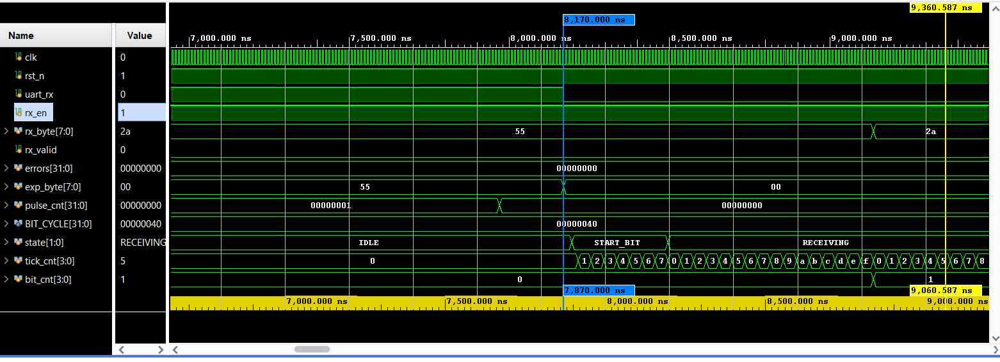
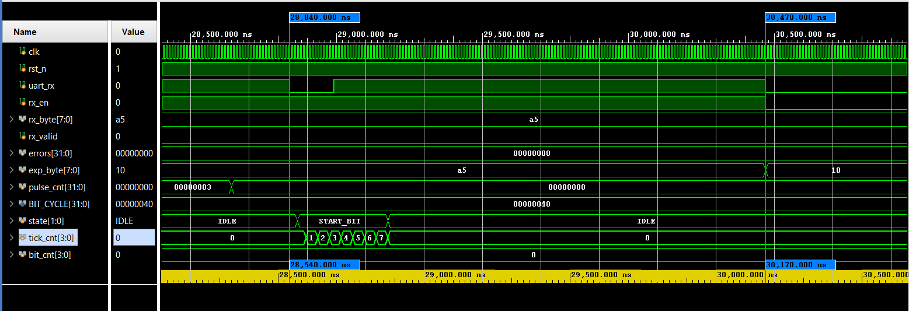

**Top level - SW15 moved during TX: the mode is held until the square ends (2078 bytes)**

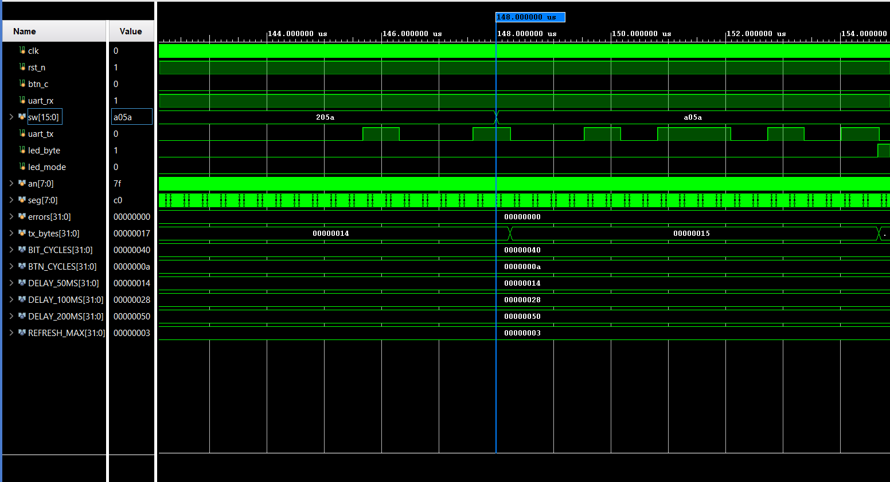
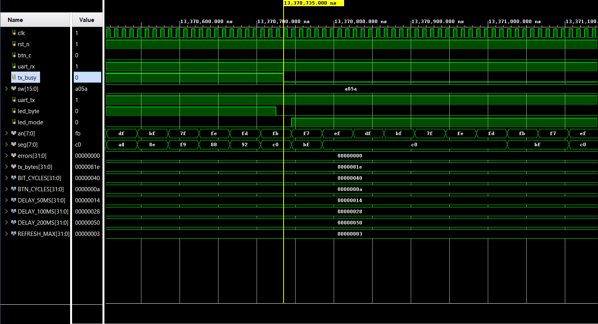

More waveforms are in [`images/sim`](images/sim).

## Board test

| # | Test | Input | Result |
|---|---|---|---|
| 1 | TX single byte | SW = `0041` | `A` in terminal, display `01 01 0.0 41` |
| 2 | TX 32x32, 50 ms | SW = `212A` | 32x32 square, rows counter up to `20` |
| 3 | RX idle | SW15 = 1 | `00 00 -- 00`, LED15 on |
| 4 | RX valid | `{R001,C002,V128}` | `01 02 -- 80` |
| 5 | RX out of range | `{R300,C005,V009}` | `E- 05 -- 09` |
| 6 | RX boundary | `{R255,C000,V100}` | `FF 00 -- 64` |
| 7 | RX broken format | `{R001;C002,V003}` | `E- E- -- E-` |
| 8 | SW15 during TX | SW15 up mid-square | TX completes, then LED15 on |

| TX 32x32 - terminal | TX 32x32 - board |
|---|---|
| 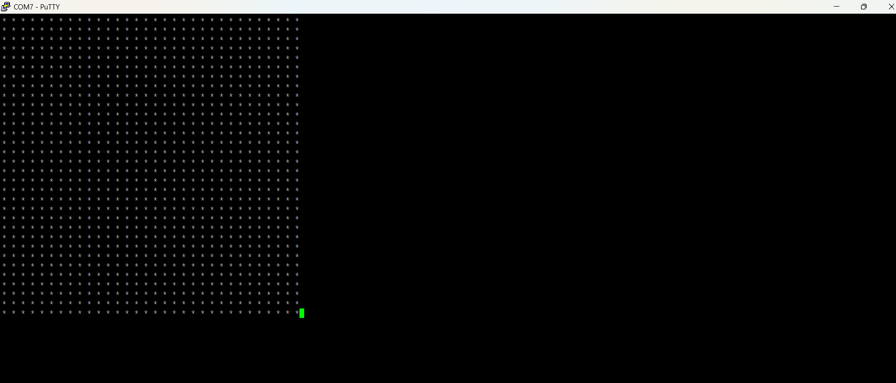 | 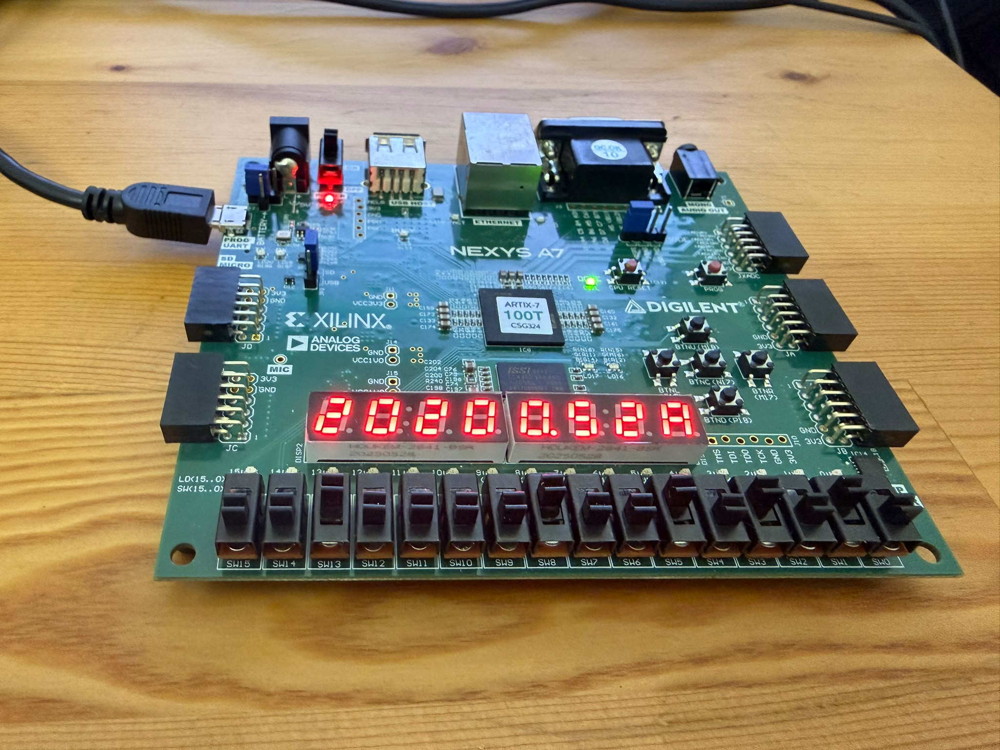 |

| RX valid | RX out of range | RX broken format |
|---|---|---|
| 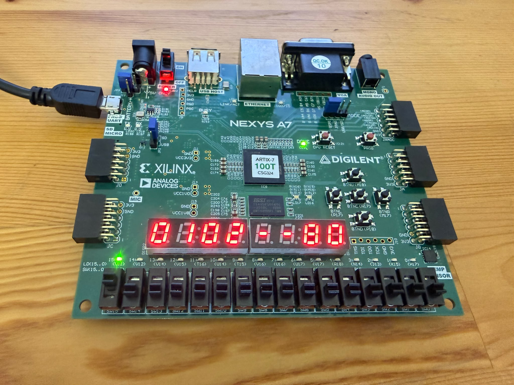 | 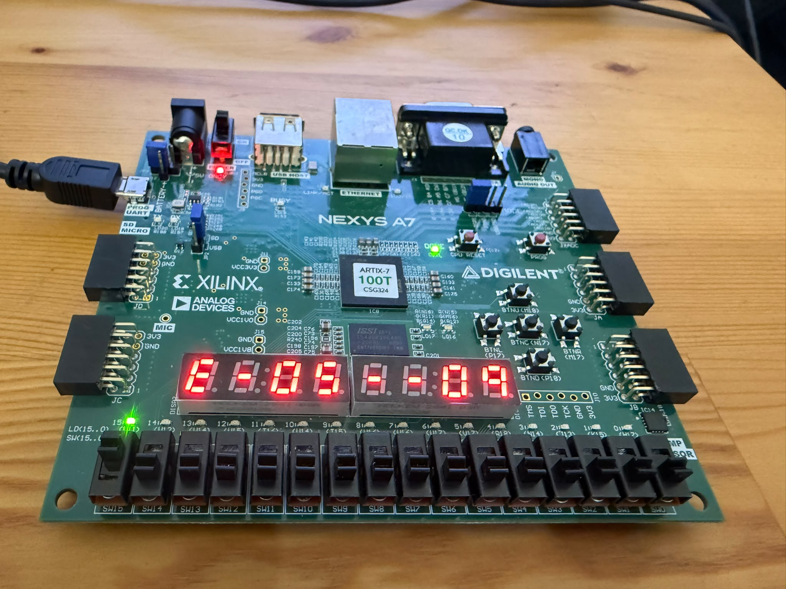 | 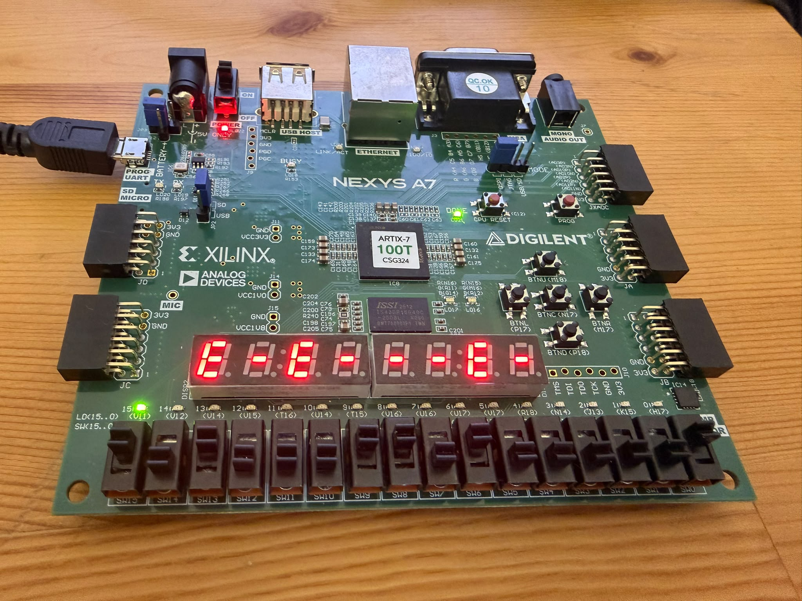 |

| SW15 up, still TX (rows 07) | SW15 up, still TX (rows 10) | TX done - RX mode |
|---|---|---|
| 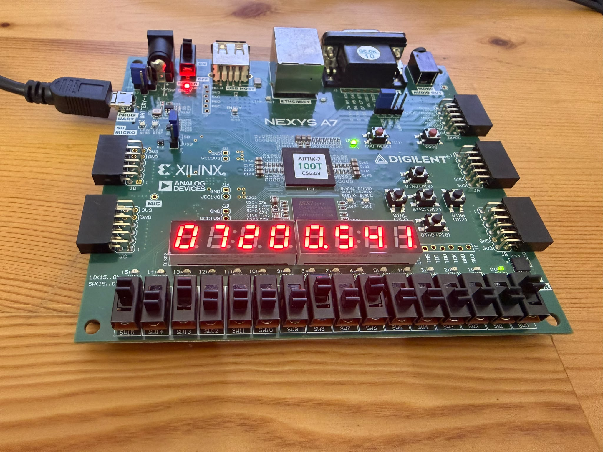 | 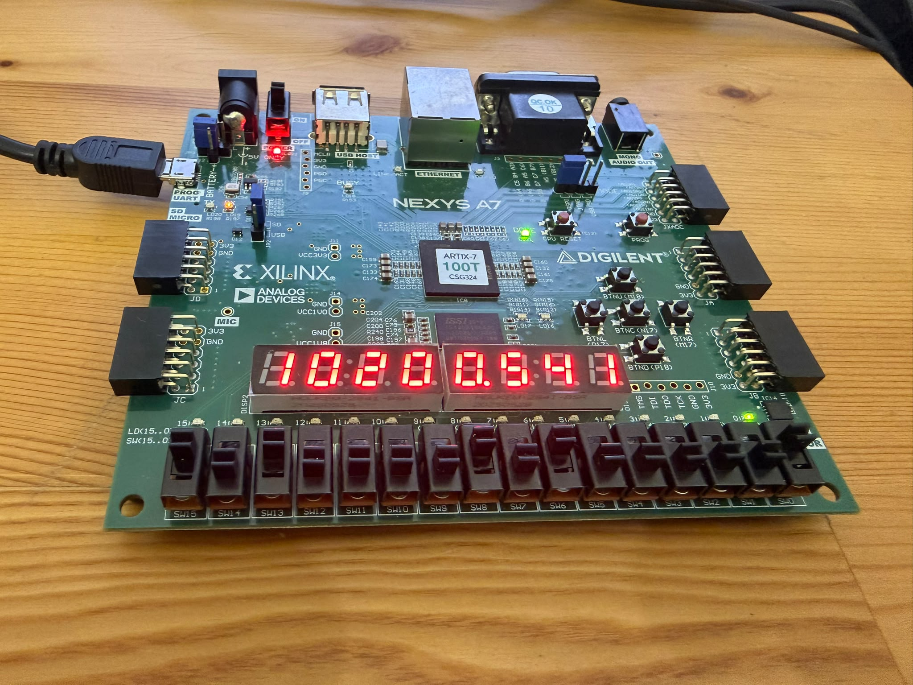 | 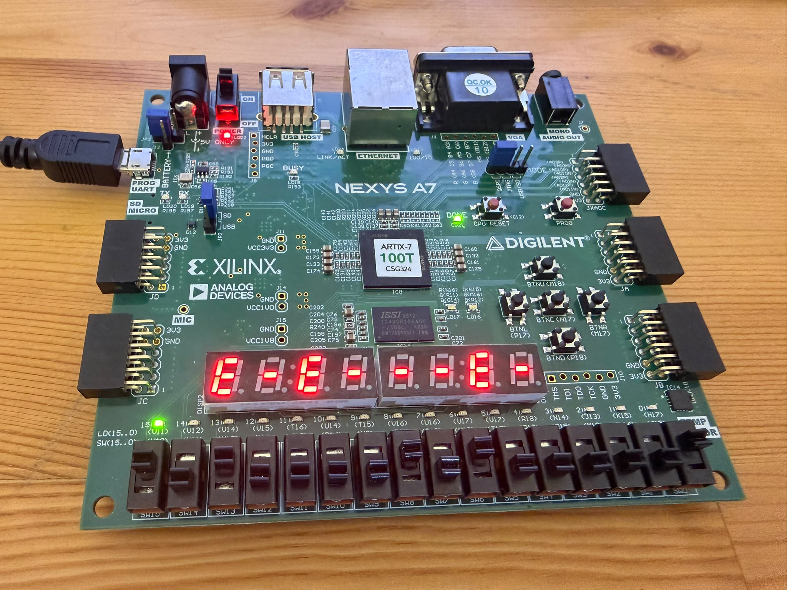 |

All board photos are in [`images/board`](images/board).

## Folder structure

```
rtl/          design sources (compile uart_pkg.sv first)
tb/           self-checking testbenches
constraints/  LAB5.xdc (Nexys A7-100T)
images/       board photos and simulation waveforms
reports/      Vivado lint, utilization and timing reports, bitstream
```

## Tools
Vivado 2025.1, Nexys A7-100T (xc7a100tcsg324-1), PuTTY at 57600 8N1.
